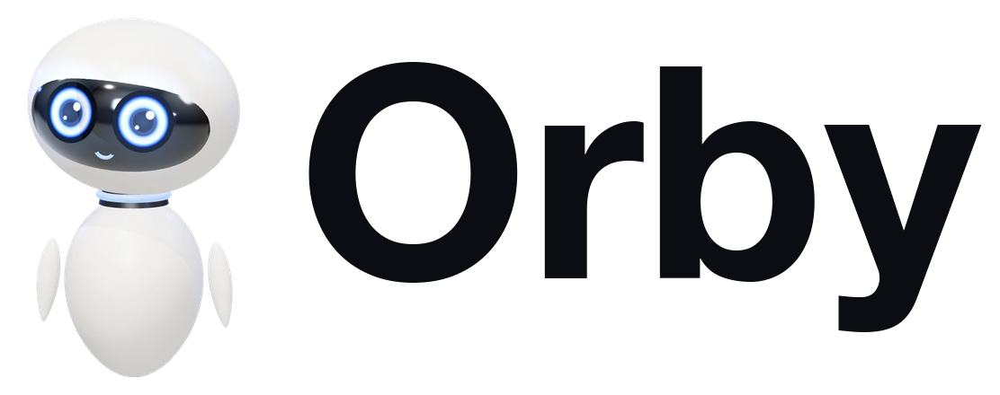

<p align="center">
  <picture>
    <source media="(prefers-color-scheme: dark)" srcset="radar/static/marca/logo-orby-oscuro.png">
    
  </picture>
</p>

# Orby

Un equipo de agentes de IA que lleva el contenido de una marca personal: investiga qué funciona en su nicho, planifica
la semana, prepara lo que hay que grabar, edita los vídeos, los publica y atiende los mensajes. Tú apruebas; ellos
trabajan.

Orby es software libre (licencia MIT). Cada cuenta conecta sus propias claves (Claude, Apify, Zernio, ManyChat…) y
paga su propio uso: el software no cobra nada.

## El equipo

| Agente | Qué hace |
| --- | --- |
| **Orby** | El director: coordina al equipo, te resume el día (en la app y por Telegram) y convierte tus correcciones en reglas. |
| **Lupi** | Sigue tus cuentas y las de tu competencia, encuentra lo que despega y lo desmonta en plantillas. Trae las noticias de tu nicho. |
| **Plani** | Planifica la semana con tus temas fijos y lo que encuentra Lupi, y prepara el «Graba hoy». |
| **Escri** | Escribe guiones o estructuras con tu voz, puntúa los ganchos y comprueba cada cifra contra tus pruebas. |
| **Monti** | Edita las tomas: quita silencios y tomas falsas, reencuadra a 9:16, subtitula y monta. De una grabación larga saca varios reels. |
| **Publi** | Programa cada vídeo en Instagram, TikTok y YouTube (con Zernio), con su texto y su enlace con seguimiento. |
| **Chati** | Responde a la palabra clave y lleva los mensajes directos a través del ManyChat del negocio. |

Todo lo que hacen pasa por **Aprobaciones**: nada se publica ni se envía sin tu visto bueno (salvo que des más
autonomía a un agente).

## Cómo aprende de cada negocio

El código es genérico. Lo que es de cada negocio vive en su **Kit de marca**, que se rellena en el onboarding:

- **Datos básicos:** nombre, web, redes, vídeos a la semana, tipo de negocio (coach o consultor, agencia,
  infoproducto o servicios) y cómo graba.
- **De 1 a 3 llamadas** (texto, audio o vídeo): de ellas salen la ficha, la voz, los temas, las pruebas, las
  historias, las objeciones, los límites, la llamada a la acción… Cada dato lleva la frase de la llamada de la que
  sale y se comprueba que está en la transcripción.
- **Kit visual:** paleta, tipografías, logo, estilo de subtítulos y cómo se mueven los gráficos.

## Arrancarlo en tu ordenador

Necesitas Python 3.12 y ffmpeg.

```bash
./arrancar.sh
```

Abre http://localhost:8000. La primera cuenta que se registra es la de administración. Las claves se pegan desde la
propia app, en **Conectores** de cada negocio.

## Publicarlo en un servidor

Un servidor con Ubuntu (por ejemplo, uno pequeño de Hetzner) y, si quieres, un dominio que apunte a su IP. Desde tu
ordenador:

```bash
./desplegar.sh <IP del servidor> [tu-dominio.com]
```

Instala Docker si falta, copia la app (sin tus datos locales ni tu `.env`), pone https automático con Caddy y la
arranca. Sin dominio, la dirección es `<ip-con-guiones>.sslip.io`. Volver a lanzarlo actualiza la app sin tocar los
datos del servidor. Más detalle en `INSTALAR.md`; para conectar ManyChat, `INSTALAR_MANYCHAT.md`.

El servidor levanta tres servicios: la web, Caddy (https) y `renders`, que renderiza los reels del motor de edición
avanzado de uno en uno para que la web siga respondiendo.

## Pruebas

```bash
python -m venv .venv && .venv/bin/pip install -r requirements.txt
.venv/bin/python -m pytest -q
```

Todas usan datos simulados: ninguna llama a servicios externos.

## Estructura

| Carpeta | Qué hay |
| --- | --- |
| `radar/` | La app (FastAPI + Jinja + SQLite). `radar/agentes/`: cada agente; `radar/editor/`: el editor de reels; `radar/connectors/`: Zernio, ManyChat, Telegram… |
| `motor_reels/` | El motor de edición avanzado (Remotion), con su manual de criterio. |
| `tests/` | Las pruebas. |

## Licencia

MIT. Ver `LICENSE`.
